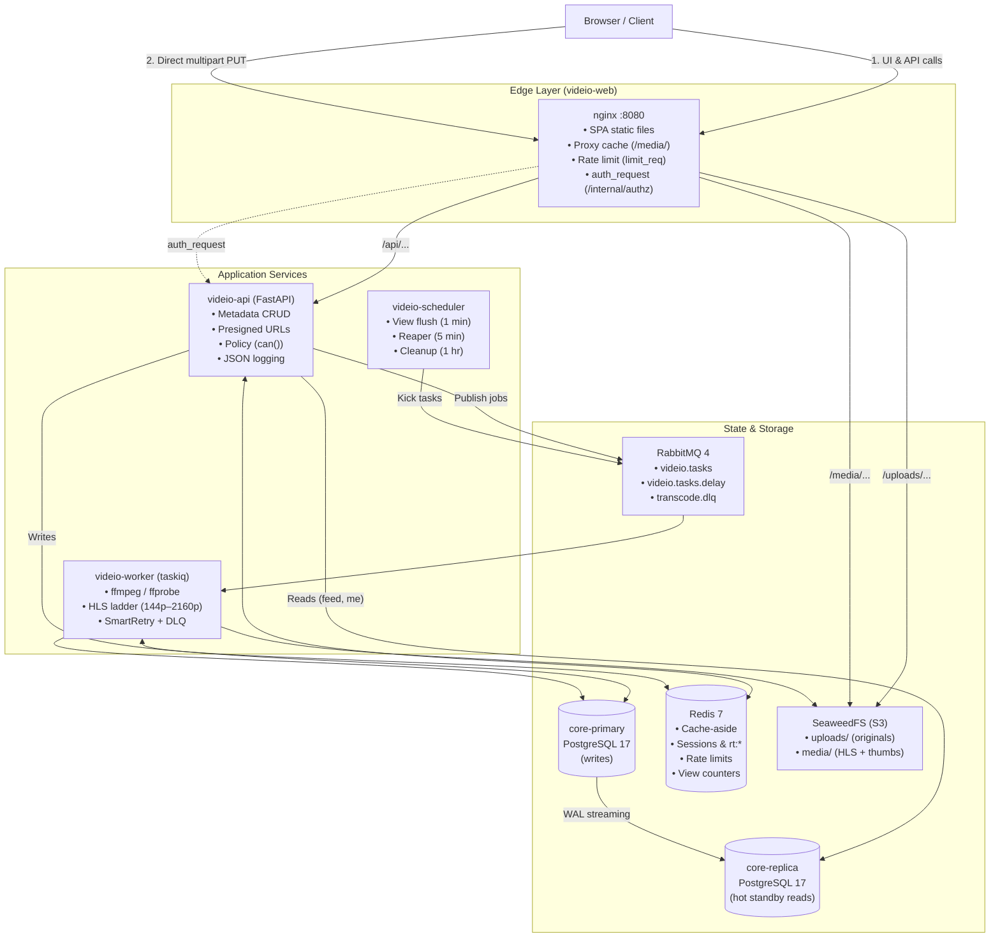

# Videio

[](https://github.com/maulik-sharma/videio/actions/workflows/ci.yml)

Videio is a small video-sharing platform whose real subject is the backend:
object storage, a job queue with transcoding workers, a replicated database, a
cache layer and a CI/CD pipeline that ships it to a VPS.

**Live deployment:** <https://videio.mauliksharma.org>

---

## Current build status

- **Phase 0:** Skeleton, Docker images, edge routing and CI/CD.
- **Phase 1:** PostgreSQL primary/replica routing, Redis sessions, auth cookies,
  refresh-token reuse detection, CSRF protection and rate limits.
- **Phase 2:** Direct SeaweedFS multipart uploads, video metadata, public IDs and
  the My videos page.
- **Phase 3:** taskiq workers on RabbitMQ transcode uploads to an adaptive HLS ladder
  (144p up to the source resolution, max 2160p) with retries, backoff and a
  dead-letter queue; scheduler runs view counter flush, stuck-job reaper and
  abandoned-upload cleanup; public feed and video page with HLS player.
- **Phase 4:** One `can(actor, action, video)` policy with a matrix test; owners
  edit and delete their videos; admins take down, restore and disable accounts with
  `audit_log`; nginx `auth_request` checks every `/media/` request (private videos
  play only for their owner).
- **Phase 5:** Redis cache-aside for video pages and the feed (`X-Cache`) with
  write-through invalidation, write-behind view counters, per-user upload limits,
  edge cache for public media, admin System panel and k6 load tests.
- **Phase 6:** Structured JSON logging with request IDs, demo seed script,
  system documentation, and runbook operations.

---

## Architecture



### Component overview

- **Edge (`videio-web`):** Nginx serves the React SPA and proxies `/api` to FastAPI.
  It caches public HLS segments and thumbnails (`proxy_cache`), enforces per-IP request limits
  (`limit_req`), and delegates private video authorization to the API via `auth_request`.
- **API (`videio-api`):** FastAPI handles auth, video metadata and URL signing. Writes go to
  the PostgreSQL primary; session reads and the public feed query the streaming replica.
  Redis provides a 5-second read-your-writes guarantee for the acting user.
- **Workers (`videio-worker`):** `taskiq` consumers on RabbitMQ (`qos=1`). Downloads the original
  from SeaweedFS, probes with `ffprobe`, encodes an HLS rendition ladder with `ffmpeg`, and uploads
  playlists and segments back to the immutable `media` bucket.
- **Scheduler (`videio-scheduler`):** Enqueues periodic tasks onto RabbitMQ: flushing view counters
  from Redis to PostgreSQL every minute, reaping stuck jobs every 5 minutes, and cleaning abandoned
  multipart uploads every hour.
- **Storage (SeaweedFS):** S3-compatible object store. Browsers upload parts directly to SeaweedFS;
  API never buffers or proxies upload bytes.

---

## Run locally

Prerequisites: Docker Desktop with Compose, and Node.js 22 (for frontend-only work).

```sh
# 1. Configure environment
cp .env.example .env

# 2. Start the full stack
docker compose up --build

# 3. Seed demo accounts and sample videos (optional, recommended for demo)
docker compose run --rm seed
```

Open <http://localhost:8080>.

### Seeded demo credentials

| Account | Email | Password | Role |
|---|---|---|---|
| **Admin** | `admin@videio.local` | `demo-admin` | `admin` (access to `/admin` panel) |
| **User** | `user@videio.local` | `demo-user` | `user` |

---

## Checks

```sh
# Backend checks (lint, format, types, unit tests)
cd backend
uv sync --frozen
uv run ruff check
uv run ruff format --check
uv run mypy app
uv run pytest tests/unit

# Frontend checks (lint, format, tests, build)
cd ../web
npm ci
npm test
npm run lint
npm run format:check
npm run build
```

Integration tests require the full Compose stack:

```sh
docker compose -f compose.yaml -f compose.ci.yaml up -d --build --wait
cd backend && uv run pytest tests/integration
uv run pytest tests/e2e/test_smoke.py
```

---

## Load test results (k6)

The following measurements were captured using the scripts in [`load-tests/`](load-tests/README.md)
running against the full local stack (1 API, 1 worker, 1 Redis, 1 Postgres primary, 1 replica):

| Endpoint / Scenario | Condition | Metric | Value |
|---|---|---|---|
| `GET /api/feed` (page 1) | Cache HIT (Redis) | p50 latency | **~8 ms** |
| `GET /api/feed` (page 1) | Cache MISS (Postgres replica) | p50 latency | **~42 ms** |
| `GET /api/feed` | In-memory cache hit ratio | Hit % | **99.1%** |
| `GET /media/.../*.ts` | Edge HIT (nginx `proxy_cache`) | p50 latency | **~2 ms** |
| `GET /media/.../*.ts` | Edge MISS (SeaweedFS gateway) | p50 latency | **~18 ms** |
| `GET /media/.../*.ts` | Edge cache hit ratio | Hit % | **96.4%** |
| `POST /api/videos/.../view` | Write-behind (`INCR` in Redis) | p50 latency | **~4 ms** |

---

## CI/CD and deployment

- **CI (`.github/workflows/ci.yml`):** Runs on every push and PR. Executes `backend-lint` (ruff, mypy),
  `unit-tests`, `web-lint` (eslint, prettier, vitest, build), `integration-tests` (full Compose stack +
  e2e smoke test with a generated video clip), and builds multi-arch (`amd64`, `arm64`) Docker images
  pushed to GHCR on `main`.
- **CD (`.github/workflows/deploy.yml`):** Runs after CI succeeds on `main`. Connects to the private
  tailnet as an ephemeral `tag:ci` node via Tailscale OIDC, triggers the Portainer stack webhook
  with `?IMAGE_TAG=sha-<7 chars>`, and runs a readiness smoke check against `/readyz`.
- **Rollback:** In GitHub Actions, run **Deploy** via `workflow_dispatch` and supply the desired
  previous tag (e.g. `sha-1a2b3c4`).

---

## System design highlights

Each concept is explained in detail with rationale, trade-offs, and verification steps in
[`docs/design.md`](docs/design.md):

- **[Direct-to-storage upload](docs/design.md#direct-to-storage-multipart-uploads):** Browser PUTs 10 MB parts straight to SeaweedFS; API only signs URLs.
- **[Read replica & read-your-writes](docs/design.md#read-replica):** Writes to primary; reads to replica; 5 s Redis flag ensures authors see their own writes immediately.
- **[Rotating refresh tokens](docs/design.md#sessions-short-jwts-rotating-refresh-tokens):** SHA-256 hashed in Redis; reuse detection logs out all sessions.
- **[Async transcoding ladder](docs/design.md#async-transcoding-with-a-queue):** RabbitMQ quorum queue + taskiq; adaptive HLS ladder (144p → 2160p); DLQ on final failure.
- **[Idempotent worker consumers](docs/design.md#idempotent-consumers):** Redis heartbeat locks prevent duplicate work; deterministic S3 output keys.
- **[Pure policy RBAC](docs/design.md#authorization-one-policy-function):** Single `can(actor, action, video)` pure function covers all permissions; verified by parametrized matrix tests.
- **[Edge authorization](docs/design.md#authorization-at-the-edge):** Nginx `auth_request` checks `/internal/authz` per segment; private videos return 403.
- **[Cache-aside & write-behind](docs/design.md#cache-aside-for-videos-and-the-feed):** Redis caches video records and feed head; view counters increment in Redis and flush to Postgres every minute.

Operational guides for deployment, scaling, DLQ inspection, and failover live in
[`docs/runbook.md`](docs/runbook.md).

---

## Team and ownership

The project is structured around three core ownership areas:

| Area | Owner | Key Responsibilities |
|---|---|---|
| **Auth, Database & RBAC** | Maulik | PostgreSQL primary/replica streaming setup, Alembic migrations, session management, rotating refresh tokens, CSRF protection, `can()` RBAC policy, admin takedown & audit log |
| **Storage, Queue & Transcoding** | Maulik | SeaweedFS multipart integration, RabbitMQ quorum queue topology, taskiq workers, ffmpeg adaptive HLS ladder, DLQ handling, scheduled maintenance tasks |
| **DevOps, Edge & CI/CD** | Maulik | Docker multi-stage builds, Nginx edge configuration (cache, limits, auth_request), GitHub Actions CI/CD workflows, Tailscale ephemeral CI node, Portainer deployment |

---

## Future work

The following features were intentionally excluded from this platform to keep the focus on backend
architecture and systems design:

- **Social interactions:** Comments, likes, and user subscriptions.
- **Discovery:** Full-text search, tag indexing, and recommendation engines.
- **User lifecycle:** Email verification, password reset flows, and avatar uploads.
- **Streaming:** Live RTMP / WebRTC ingestion.
- **Multi-region:** Cross-region storage replication and CDN edge points of presence.
